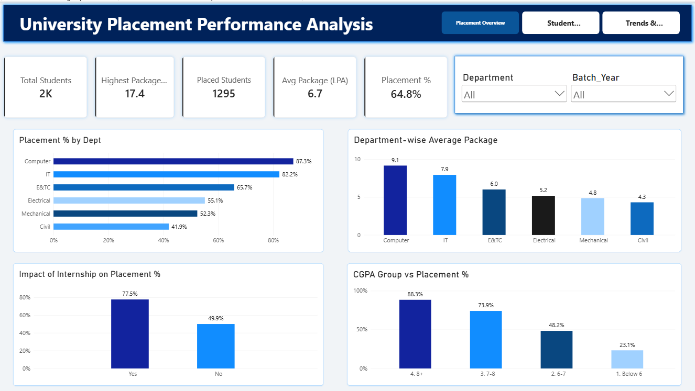
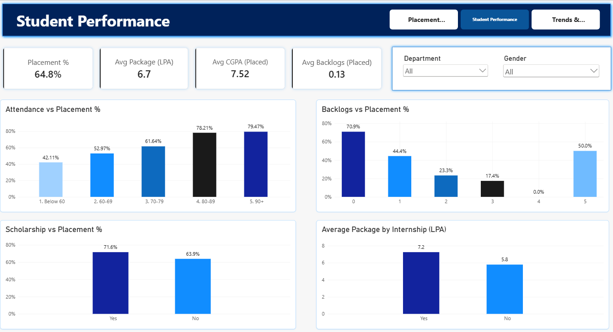
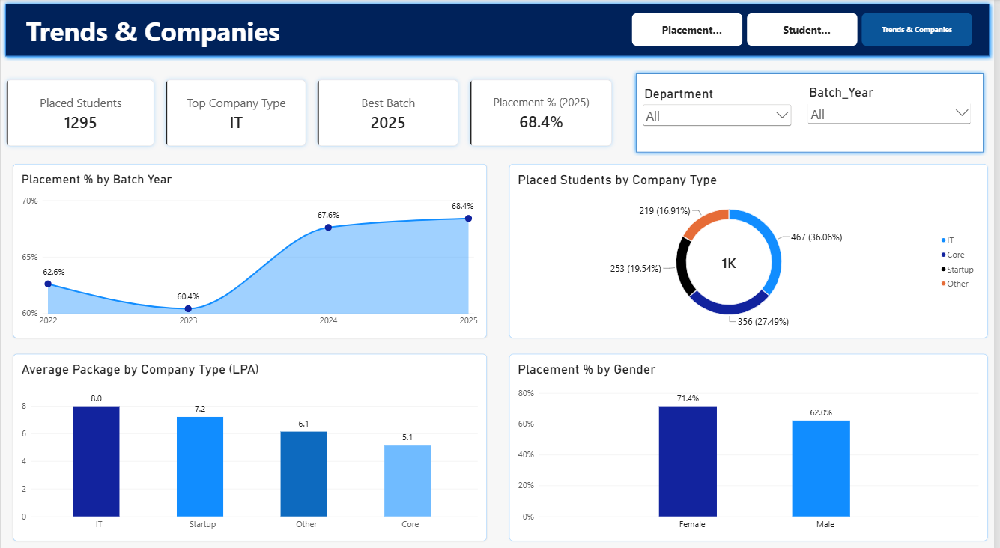

#  University Placement Performance Analysis

A data analytics project focused on analyzing university placement performance, student academic indicators, internship experience, and company placement trends using Power BI, Excel, and CSV data.

##  Dashboard Preview

### 1. Placement Overview

### 2. Student Performance

### 3. Trends & Companies

##  Project Objectives

- Analyze overall student placement performance.
- Calculate the placement rate and average salary package.
- Compare placement outcomes across departments.
- Understand the relationship between internships and placement outcomes.
- Analyze academic factors such as CGPA, attendance, and backlogs.
- Explore placement trends by batch year and company type.

##  Tools & Technologies

- **Power BI** – Interactive dashboards, KPIs, charts, and data visualization.
- **Microsoft Excel** – Data exploration and summary analysis.
- **CSV** – Source dataset for student placement analysis.

##  Dataset Information

- **Dataset:** University Placement Data
- **Total Records:** 2,000 students
- **Total Columns:** 16
- **Data Files:** `university_placement_data.csv` and `student_placement.xlsx`
- **Dashboard File:** `Placement.pbix`

##  Key Insights

- **Total Students:** 2,000
- **Students Placed:** 1,295
- **Students Not Placed:** 705
- **Overall Placement Rate:** 64.8%
- **Average Package of Placed Students:** 6.73 LPA

### Analysis Highlights

- Compared placement rates across different departments.
- Analyzed average packages across departments and company types.
- Examined placement outcomes for students with and without internships.
- Explored academic performance indicators and placement results.
- Analyzed placement trends across different batch years.

*Note: These findings describe patterns in the dataset and do not prove that any single factor causes placement success.*

##  Dashboard Pages

### Page 1: Placement Overview
- Total students and placement KPIs.
- Department-wise placement comparison.
- Average package analysis.
- Internship and placement analysis.
- Interactive filters for exploring the data.

### Page 2: Student Performance
- Attendance and placement comparison.
- Backlog analysis.
- Scholarship-based placement comparison.
- Internship and package analysis.

### Page 3: Trends & Companies
- Batch-year placement trends.
- Company-type analysis.
- Average package comparison.
- Gender-wise placement analysis.

##  How to Use This Project

1. Download or clone this repository.
2. Open `Placement.pbix` in Microsoft Power BI Desktop.
3. If prompted, update the data source path to `university_placement_data.csv`.
4. Refresh the data if required.
5. Explore the dashboard pages and interact with the available filters.

##  Future Scope

- Add more academic years for historical comparison.
- Develop a student placement-readiness analysis.
- Add detailed department-wise and company-wise drill-through reports.
- Publish the dashboard using Power BI Service.
- Expand the analysis with additional student performance indicators.

